# Scroll & Ink: two parchment look and feels for Swing

Two experimental Java Swing look and feels that try to look like things you could physically make: paper, ink and wax.

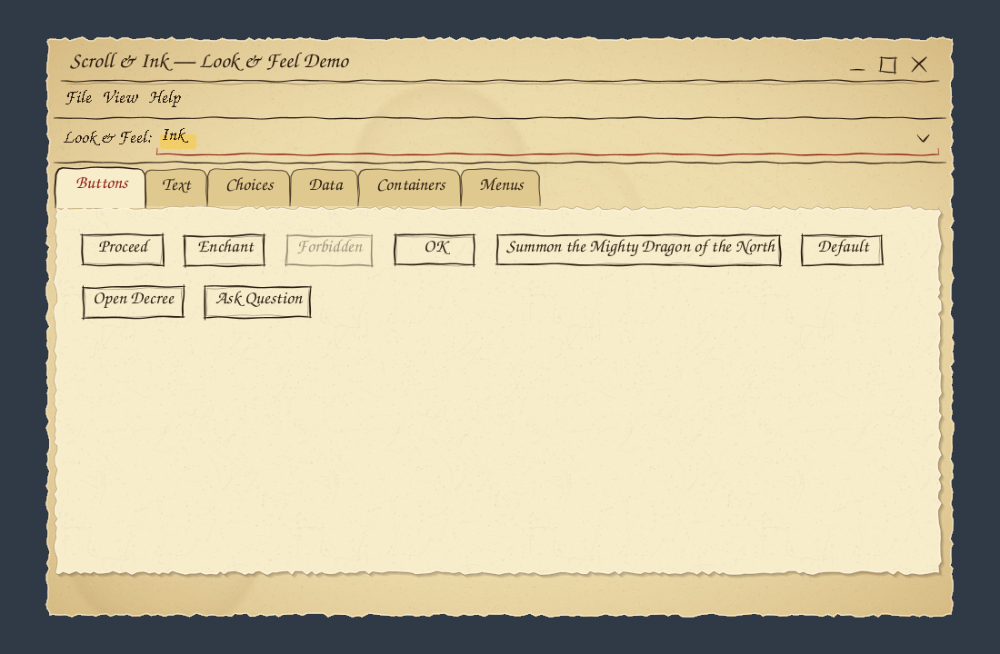

| | |
|---|---|
| **Ink** (`inklaf`) | The whole window is one sheet of parchment. Controls are pen scribbles on it: sketched boxes, a fill-in line for a text field, a quill tick for a checkbox, a highlighter swipe for a selection. Scroll panes, tab pages, popup menus and tooltips are torn slips of paper lying on the sheet. The window itself can be drawn by the look and feel, with a torn outline, a hand-lettered title and pen-drawn window buttons. |
| **Scroll** (`scrolllaf`) | Controls are objects: buttons are little scrolls with rolled ends and a ribbon, scrollbar thumbs are scroll rolls, slider thumbs are wax seals, checkmarks are quill ticks. The older of the two, more conventional in structure. |

Both are plain Swing, with no dependencies beyond the JDK.

## Ink

| | |
|---|---|
| 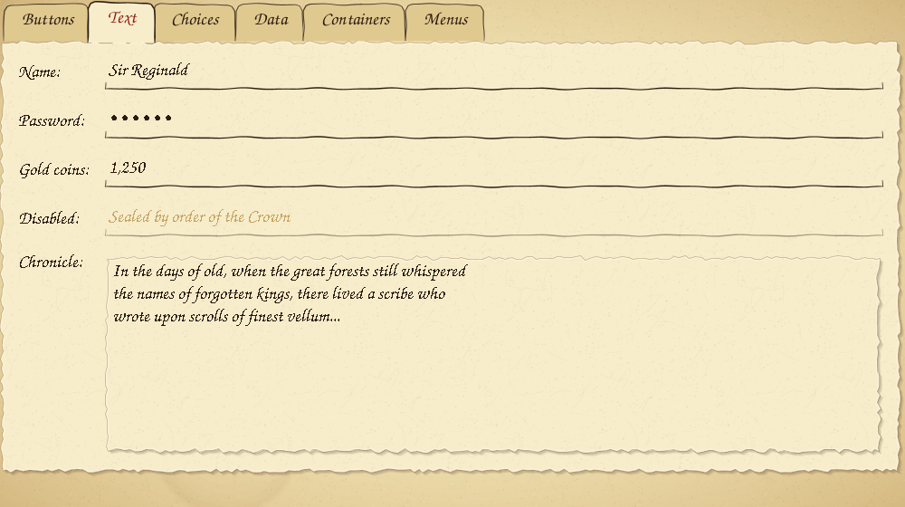 | 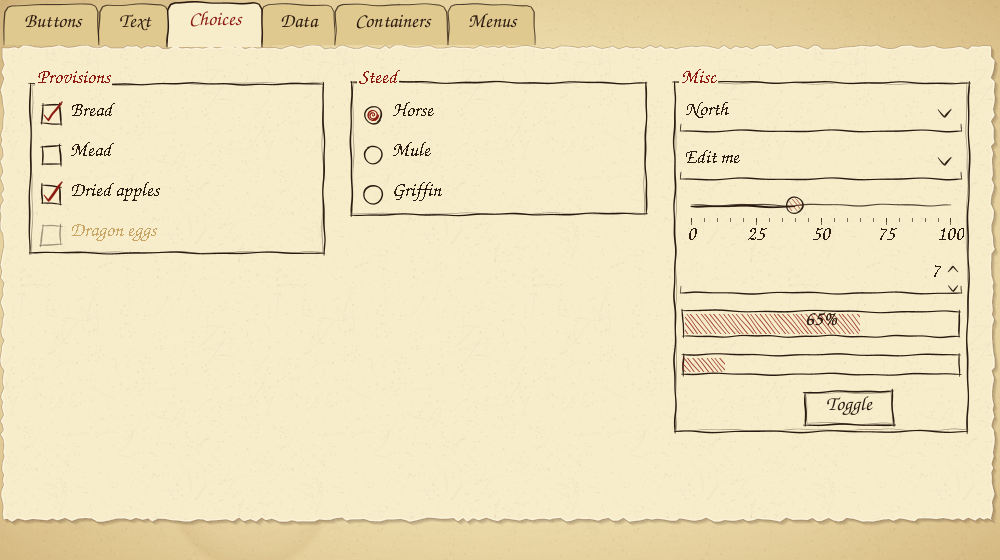 |
| 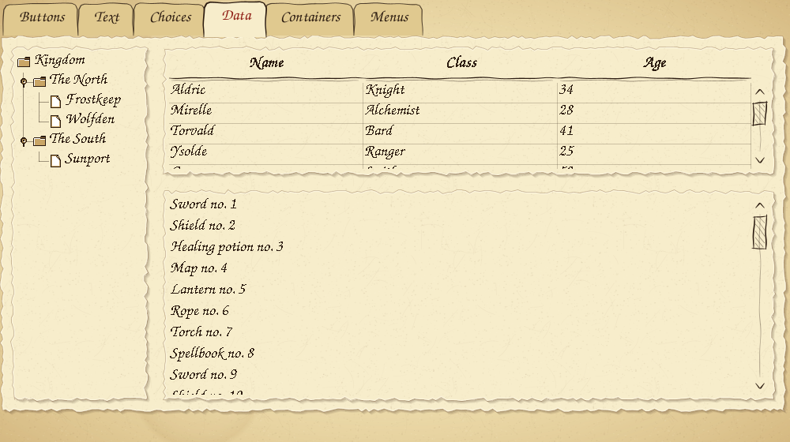 | 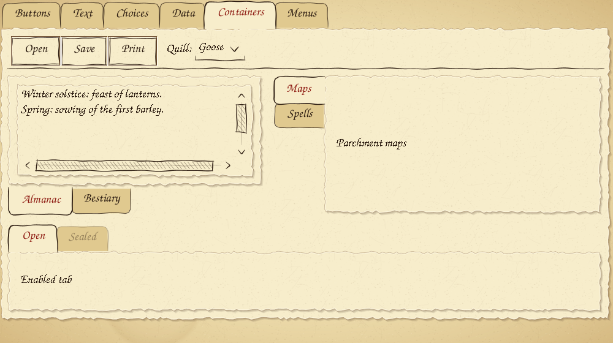 |

Button states (normal, hover traced in red, pressed and hatched in, disabled, selected) and the check and radio marks:

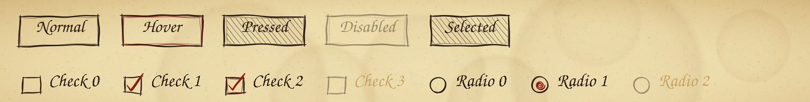

Menus and tooltips are torn slips; the armed item gets a highlighter swipe. Dialogs get the same window treatment as frames:

| | |
|---|---|
| 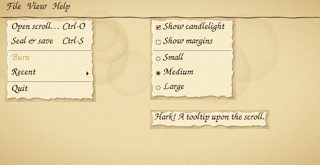 | 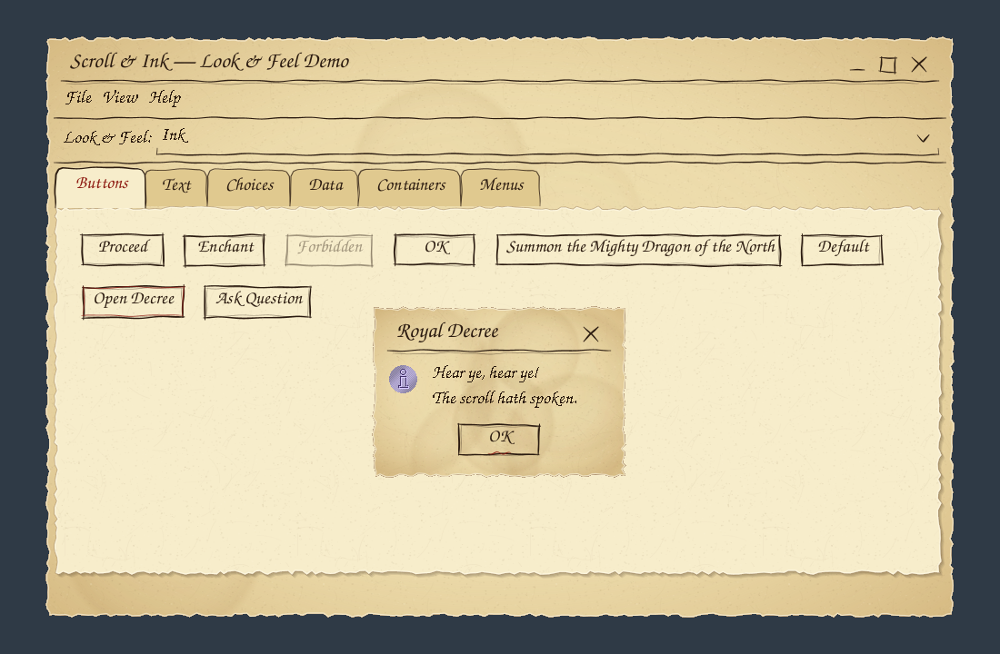 |

Every control is drawn with a small pen engine (`Pen`): the line wobbles, the width varies with a broad nib, ends taper, and the corners of a box overshoot and miss as they do freehand. Each control draws a little differently, but always the same way, so nothing jitters on repaint and screenshots are reproducible.

## Scroll

| | |
|---|---|
| 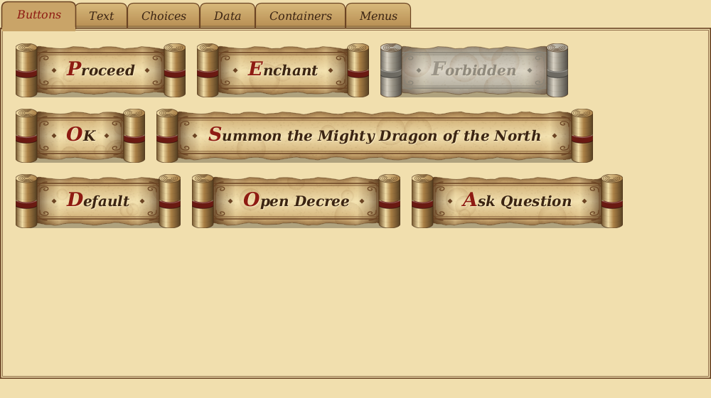 | 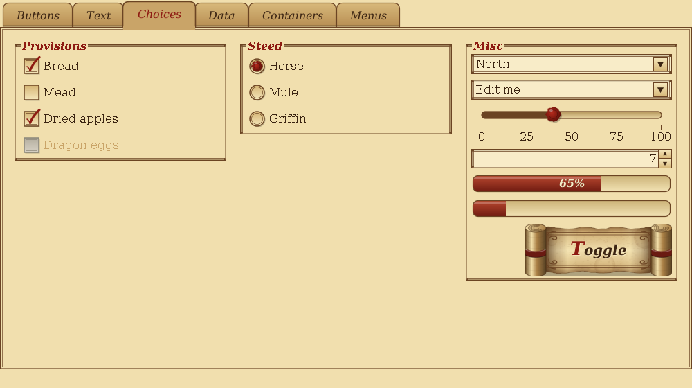 |
| 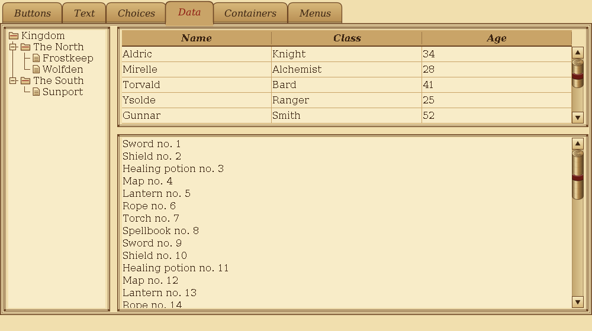 | 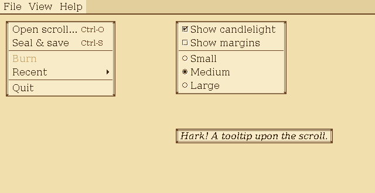 |

The original button design study is in `prototype/` and looks like this:

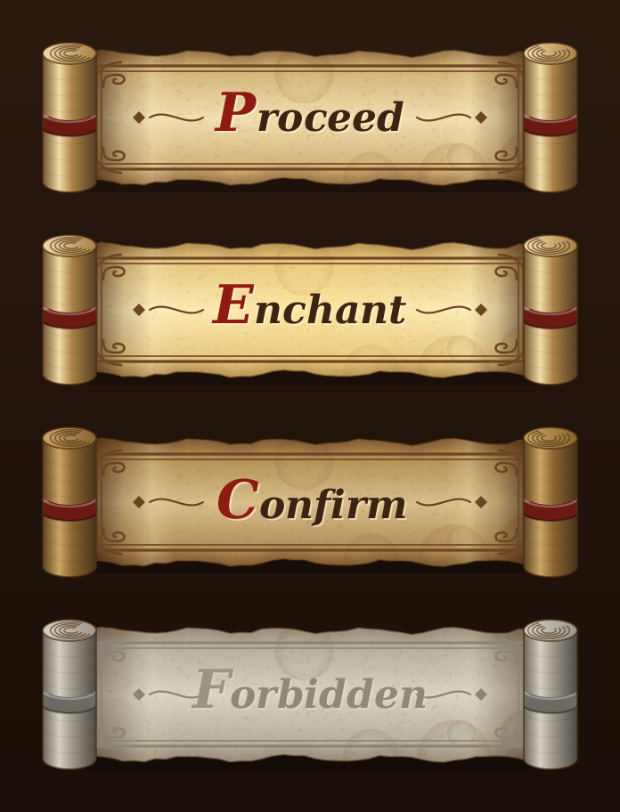

## Requirements

* Java 17 or newer (it uses pattern matching for `instanceof` and switch expressions).
* Ink looks best with a calligraphic font. It uses `Z003` if installed (package `fonts-urw-base35` on Debian and Ubuntu) and falls back to the system serif in italics. No font is bundled.

## Try it

```bash
./run-demo.sh            # SwingSet-style demo, starts in Scroll
./run-ink-demo.sh        # starts in Ink, with Ink's own window frame
./run-demo.sh ink 2      # Ink at UI scale 2 (HiDPI test); also: scroll, metal, nimbus
```

The demo rebuilds only when a source file is newer than the build. The look and feel dropdown switches live; because Swing fixes a frame's decorations when it is created, switching builds a fresh frame at the same position.

## Use it

```java
UIManager.setLookAndFeel(new inklaf.InkLookAndFeel());     // or new scrolllaf.ScrollLookAndFeel()

// Ink only, optional: let the look and feel draw the window frame.
// Call before creating frames and dialogs.
JFrame.setDefaultLookAndFeelDecorated(true);
JDialog.setDefaultLookAndFeelDecorated(true);
```

Compile `src/inklaf` and/or `src/scrolllaf` into your project; `src/demo` is only the demo. `./build.sh` compiles everything into `out/`.

Switches for Ink windows:

* `-Dink.noShape=true`, or `UIManager.put("Ink.tornWindow", false)`: plain rectangular windows instead of the torn outline.
* Client property `Ink.compact` on a button: tool-bar sized button (buttons in a `JToolBar` are compact automatically). Scroll has `Scroll.compact` for the same.

## How it works (the parts worth knowing)

* **One sheet.** Containers do not paint a flat colour; they ask `InkPaper` to paint paper, and it does so in window (root pane) coordinates. Partial repaints of any component therefore line up exactly, and the vignette, stains and fibre texture belong to the whole window. Text components, lists, tables and trees use transparent background colours and paint paper in their UI delegates for the same reason.
* **Slips.** Scroll panes, tab pages, popups and tooltips draw a torn-edge slip with a soft shadow. Components that sit on a slip are painted with slip paper automatically.
* **Repaint safety.** Swing repaints only the rectangle a thumb moved through, so anything drawn outside a thumb's own rectangle leaves a trail. Thumbs are clipped and insets keep outlines inside. Pen strokes depend only on distance from the stroke's start, so a longer stroke is the shorter one extended and a partial repaint matches a full one. `run-tests.sh` checks this for scrollbars and sliders in both look and feels.
* **HiDPI (Scroll).** The expensive button artwork is rendered once per size, label, state and device scale, and drawn at 1:1 device pixels.
* **Window shape cost (Ink).** A shaped window is noticeably more expensive to move than a plain one: the X server clips against the whole outline on every step (measured at roughly two to three times the cost per move). Ink drops the shape while you drag or resize and restores it on release.
* **Viewports** use simple scrolling, because blitting would drag the paper texture along with the content.

## Status and limits

* This is a spike, not a finished product. Checked so far: headless renders of every demo screen, repaint tests, and a real window with mouse-driven move, resize, close and dialogs on a virtual X display (Xvfb, no window manager).
* **Not verified:** maximise and restore (needs a window manager), a real HiDPI screen, Nimbus switching in a live window, and behaviour on Windows and macOS. The torn window shape relies on the system supporting shaped windows and falls back to a rectangle if it does not.
* Undecorated windows lose native window-manager behaviour such as snapping and tiling, which is why Ink's own frame is opt-in.
* **Not styled yet** (these stay plain Metal in the parchment palette): file chooser, colour chooser, internal frames, desktop pane, the blue and green dialog icons in Ink, and some rarely used components.
* The code is Swing-idiomatic but not tuned for large UIs; every Ink stroke is computed at paint time.

## Layout

```
src/inklaf/       Ink look and feel (Pen, InkPaper, UI delegates, window frame)
src/scrolllaf/    Scroll look and feel
src/demo/         SwingSet-style demo (ScrollSwingSet)
test/             Repaint-trail checks (run-tests.sh)
prototype/        The first single-button design study for Scroll
docs/images/      Screenshots used in this README
build.sh  run-demo.sh  run-ink-demo.sh  run-tests.sh
```

## License

[MIT](LICENSE), © 2026 Cyberbeest. Use it for anything, commercial or not; just keep the copyright notice.
